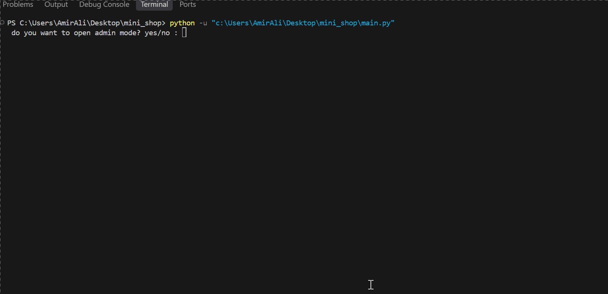

# Mini Shop


A simple python shopping program
## Table of Contents
  

- [Table of Contents](#table-of-contents)
- [Features](#features)
- [Project Structure](#project-structure)
- [Requirments](#requirments)
- [Installation](#installation)
- [Envoirment Setup](#envoirment-setup)
- [Usage](#usage)
- [Exmaple Output](#exmaple-output)
- [Roadmap](#roadmap)
- [screenshot](#screenshot)
- [Contributing](#contributing)
- [Licence](#licence)
- [Author](#author)

## Features
- get admin code
- get the customers name
- show available products
- choose a product
- enter the quantity
- calculate the total price
- save order information file

## Project Structure
```text
Mini-shop/
│   .env.example
│   .gitignore
│   main.py
│   products.py
│   README.md
├───gifs
│       Animation.gif
├───pic
│       1.png
│       2.png
│       3.png
└───
```

### file discription
| file | discription | 
| --- | --- |
|`main.py` | themain file that runs the mini shop program.|
| `products.py` | contains the products and their prices|
| `.gitignore` | prevents unnecessary files such as|
| `readme.md` | about the project|
| `pic` | stors project screenshot|
| `gifs` | stors demo gifts file|
  
## Requirments

Before running the project, make sure you have:
- `python 3`
- `python-dotenv`


## Installation
1. open a terminal in the project folder.
2. check that python is installed:
```bash
python --version
```
3. install the python packages:
```bash
pip install -r Requirments.txt
```


## Envoirment Setup
1. create a `.env` file from `.env.example`:
```bash
cp .env.example .env 
```
2. open the new `.env` file 
3. replace the example value with your own password
```text
QUIZ_ADMIN_PASWORD=your_password_here
```
4. save the file.
5. 
> Do not commit your `.env` file beacause it may contain private information

## Usage

1. open a terminal in the project folder 
2. run the mini shop
```bash
python main.py
```
3. choose `yes` or `no` for admin mode
4. if you choose `yes`, enter the password from your 
`.env` file 
5. enter your name
6. choose products 
7. write thenumber
8. your result is saved in `results.txt`
   
## Exmaple Output

```
Whats your name? a
Welcome to Mini Shop
Products:
Laptop - 800 $
Phone - 500 $
Headphones - 50 $
Keyboard - 30 $
Which product do you want? Keyboard
How many do you want? 10
Total price: 300 $
Purchase saved
```

## screenshot

### start 


### pruduct


### end


## Demo




## Roadmap
- [x] admin yes/no
- [x] saved Information
- [x] save results to a file
- [x] add admin mode
- [ ] add more question
- [ ] add a timer

## Contributing


## Licence

## Author
create by [amirali](https://github.com/amirali-bashiri1)

